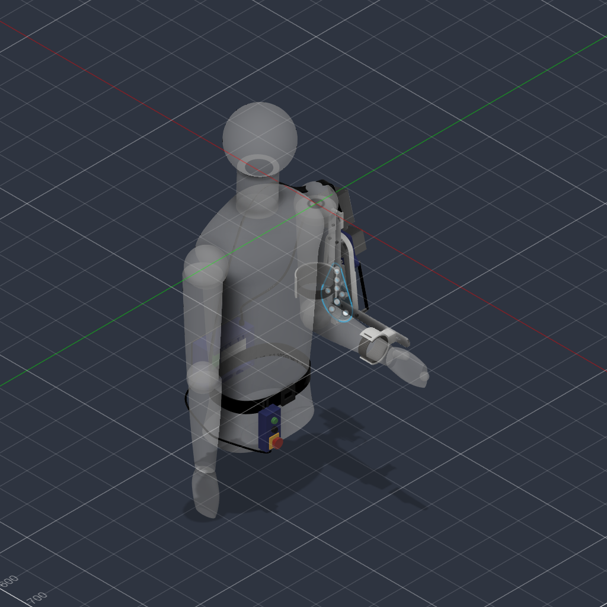

# exo-arm



A single-degree-of-freedom powered elbow worn on the right arm. A NEMA 23
stepper drives the elbow through a 15:1 worm; a sling and waist belt carry
the shoulder; the wearer commands it with a hand pendant.

This repository holds the Fusion design, the firmware, and the documentation
needed to build, commission and operate it.

> **A workshop build, not a product.** It is not a medical device, it meets no
> standard, nobody qualified has assessed it, and it has never run against
> hardware. Read [docs/safety.md](docs/safety.md) before anyone puts it on.

## The machine

| | |
|---|---|
| Degrees of freedom | 1 — elbow flexion and extension |
| Actuator | NEMA 23 stepper, 1.9 N·m, through an NMRV030 worm at 15:1 |
| Output | ≈ 20 N·m at the elbow after worm losses, against ≈ 2.8 N·m of load |
| Resolution | 24 000 microsteps per output revolution, 66.7 per degree |
| Travel | 0° (full extension) to 135° of flexion |
| Control | Arduino Uno and a TB6600 driver, belt-mounted |
| Interface | UP / DOWN buttons and a latching NC e-stop on a hand pendant |
| Device mass | 3.285 kg |

The worm is the fact that shapes everything else. At 15:1 it is self-locking:
the elbow holds its angle with the motor de-energised, so there is no holding
current, no gravity compensation to compute, and nothing to tune. It also
means the wearer cannot backdrive the arm, which is why the e-stop cuts
driver power rather than asking the firmware to be well behaved.

## Layout

| Path | What is in it |
|---|---|
| `firmware/` | Arduino Uno firmware: motion planning, step generation, interlocks |
| `cad/` | The Fusion design, STEP and STL exports, and measured mass properties |
| `docs/` | Design, safety, wiring, BOM, commissioning, operation |
| `tools/fusion/` | Read-only Fusion script that regenerates everything in `cad/` |

## Firmware

```bash
cd firmware
pio run -e uno              # build
pio run -e uno -t upload    # flash
pio device monitor          # status at 115200 baud
pio test -e native          # unit tests, on the host
```

Holding a button produces a velocity, not a step: the planner ramps up, holds
at 20°/s, and begins decelerating early enough to come to rest at the travel
limit rather than arriving at it under power. That matters more than it
sounds — a stepper stopped dead at speed loses steps, and with no encoder the
step counter is the only idea the firmware has of where the arm is.

That counter is referenced to a lever switch at full extension. Reaching it
sets zero; until it is reached the arm is held to 90° at 5°/s, because the
count is an assumption about how the arm was parked and not worth more than
that. Where the switch and the counter disagree the switch wins, and past
five degrees of disagreement it faults rather than correcting, because that
much lost motion means the flexion limit moved too.

The switch is not homed to automatically. The arm moves only while a button
is held, and that rule was worth keeping more than a session that starts at
full range: the zero is adopted during an extension the wearer was commanding
anyway.

Four things are enforced below the planner: the step generator refuses to
pulse past the travel limits whatever it is told, the e-stop drops the driver
enable before anything else runs, both buttons at once reads as stop rather
than as a guess, and the supply current is watched while the arm drives so a
bind faults it out.

That last one is inferred rather than measured, and `docs/safety.md` is
explicit about what it cannot catch. A shaft encoder would make it exact.

Faults and homing corrections go to EEPROM and are printed at the next
power-on, because a fault reason is gone by the time the wearer has switched
off and the drift figure only means anything as a trend. There is no serial
command to read it: this firmware accepts no serial input at all, and keeping
that true was worth more than a nicer interface.

## Safety model

The e-stop loop is normally closed to ground. A pressed mushroom, an
unplugged pendant and a cut cable all read identically: open, meaning stop.
It breaks the driver supply in hardware as well as being read by the
firmware, so the motor dies whether or not the Arduino is behaving.

At power-on the firmware starts in a fault state and will not leave it until
the e-stop reads closed **and** both buttons are released, so a stuck button
cannot drive the arm the moment power arrives.

The home switch is wired the opposite way round, normally open, and
deliberately so. For a stop command the safe reading of a broken wire is
"stop"; for a position reference it is "I do not know where I am". Wired
normally closed, a cut cable would read as "at home" and the firmware would
invent a zero wherever the arm happened to be.

## Where to start

- Building one: [docs/bom.md](docs/bom.md), then [docs/wiring.md](docs/wiring.md)
- Understanding the design: [docs/design.md](docs/design.md)
- Bringing one up: [docs/commissioning.md](docs/commissioning.md)
- Using one: [docs/operation.md](docs/operation.md)
- The CAD and its measured numbers: [cad/README.md](cad/README.md)

## Status

The mechanical design is substantially complete in CAD, with two known
omissions: the travel hard stops and the home switch bracket are specified in
the docs but not modelled, and [docs/safety.md](docs/safety.md) explains why
that matters more than it sounds.

The firmware is written and its planning, step-rate, debounce, load, homing
and logging logic are covered by 59 host unit tests, but **it has never been run
on hardware**. The pin assignments in `firmware/include/config.h` are a
proposal, not a built wiring loom, and the direction sense has not been
verified against a real motor. Work through
[docs/commissioning.md](docs/commissioning.md) before the arm is worn.

## License

MIT, see [LICENSE](LICENSE).
