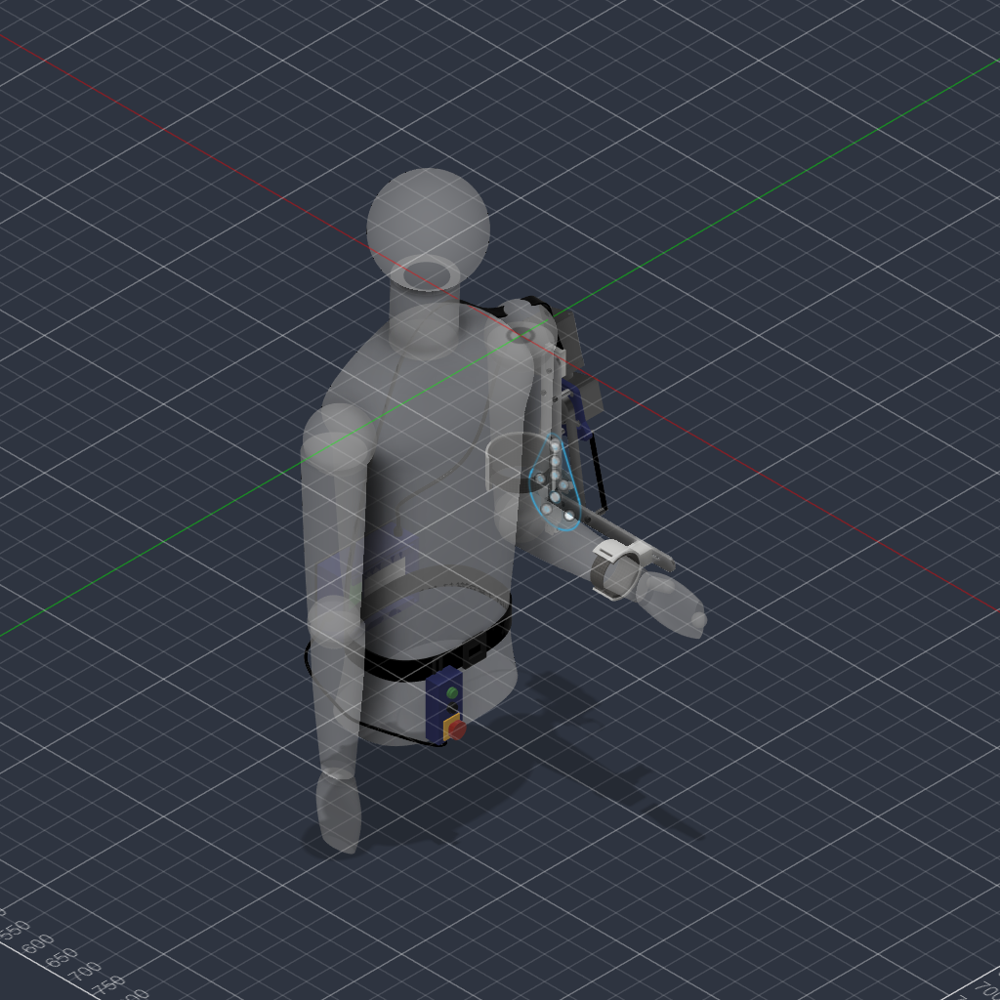

# CAD

The mechanical design, as modelled in Fusion 360.

| File | What it is |
|---|---|
| `source/BudgetExoArm.f3d` | Fusion archive of the design |
| `step/BudgetExoArm.step` | STEP export, openable without Fusion |
| `mesh/BudgetExoArm.stl` | Mesh export. GitHub renders this in the browser |
| `BudgetExoArm.design.json` | Every component, body and joint, with mass, volume and centre of mass |
| `BudgetExoArm.bodies.csv` | The same body data as a spreadsheet |

All of these except the image are generated by `tools/fusion/ExoArmExport.py`.
Run it again after any design change so the numbers below, and the constants
in the firmware, stay tied to the model rather than to memory.

## Regenerating

The script is installed per-machine, not from this repository:

1. Copy `tools/fusion/` contents into a folder named `ExoArmExport` under
   `%APPDATA%\Autodesk\Autodesk Fusion 360\API\Scripts\` (Windows) or
   `~/Library/Application Support/Autodesk/Autodesk Fusion 360/API/Scripts/` (macOS)
2. Open the design, then **Utilities → Scripts and Add-Ins → ExoArmExport → Run**
3. Point it at this `cad/` folder

It only reads and exports. It also refuses to run if the timeline marker is
not at the end, because a rolled-back timeline exports a mid-edit state as if
it were the design. That happened once, and this repository described the wrong
machine until it was caught.

## Coordinate frame

Fusion's origin sits at the wearer's right shoulder. Z is up, so the arm
hangs in −Z. X runs forward, the direction the forearm points in the modelled
pose. Y runs to the wearer's left, where the drivetrain is mounted.

Figures are millimetres and kilograms, taken from the model unless marked as
calculated.

## Layout

| Item | Position (mm) | Notes |
|---|---|---|
| Shoulder centre | (0, 0, −10) | Wearer reference |
| Elbow axis | Along Y, through x = 0, z = −330 | M8 shoulder bolt in two bronze bushings |
| Gearbox output and 15T sprocket | Along Y, through x = 0, z = −172 | 158 mm above the elbow |
| 30T elbow sprocket | y 77.6 to 82.9 | Moves with the forearm |
| Upper strut | y 62.0 to 66.8, z −374 to −64 | 1.5 × 3/16 in 6061 |
| Forearm strut | y 67.8 to 72.6, x −33 to 253 in the modelled pose | 1 × 3/16 in 6061 |
| Forearm cuff | Centred at x = 193 | 193 mm from the elbow |

## Elbow travel

"Flexion" here means the true angle from a straight arm. The modelled pose is
90°, with the upper arm along −Z and the forearm along +X.

| Point | True flexion | Firmware angle | Source |
|---|---|---|---|
| Extension stop contact | about 21.2° | about −2.4° | Calculated from the measured gap at the joint limit |
| Fusion joint limit, extension | 22° | −1.5° | Joint limit |
| Home switch closes | about 23.5° | 0° | Modelled target, see below |
| Flexion soft limit | about 111.5° | 88° | `kMaxAngleDeg` |
| Overrun switch closes | about 114.5° | 91° | Modelled target, `kFlexSwitchAngleDeg` |
| Fusion joint limit, flexion | 117° | 93.5° | Joint limit |
| Flexion stop contact | about 117.6° | about 94.1° | Calculated from the measured gap at the joint limit |

So the arm never fully straightens, and travel is about 96° between the stops.
The firmware's zero is the home switch, not a straight arm: add about 23.5° to
a firmware angle to get true flexion.

The hard stops are 10 mm steel spacers on the upper strut, each 30 mm from the
pivot, and the forearm strut's edge strikes them. The rubber bumper sleeves sit
at y 72.6 to 76.6, above the strut's plane, so as modelled they do not touch
it. The stops are therefore steel on aluminium until that is resolved.

## Switch mounts

Two KW12-style lever microswitches, each on a 3 mm 6061 bracket on the inboard
face of the upper strut, with the switch standing on 4.9 mm spacers so the
lever sits in the forearm strut's plane. Each bracket takes two M3 screws
through 3.2 mm holes in the upper strut, and the switches use 2.4 mm holes on
9.5 mm centres.

Checked by rotating the real elbow joint through its limits at 15 poses:

| Check | Result |
|---|---|
| New parts clashing with anything except the strut pressing a lever | None |
| Home lever first touched | About 25.6° true flexion |
| Overrun lever first touched | About 112.1° true flexion |
| Strut to home switch body at the 22° joint limit | 2.0 mm |
| Strut to overrun switch body at the 117° joint limit | 1.3 mm |
| Mass of every other existing body after the work | Unchanged |

**The closing angles are a target, not a measurement.** The levers are simple
modelled shapes placed so a real switch with about 1.2 mm of lever pre-travel
would close at the target angle. Real switches differ, so
[commissioning](../docs/commissioning.md) measures both closing points on the
built arm, and those measurements decide.

## Mass

| Component | Mass (kg) | Bodies | Notes |
|---|---|---|---|
| Upper Arm Module | 2.910 | 42 | Gearmotor 2.19, chain 0.27, struts, cuff, 15T sprocket |
| Harness + Electronics | 0.765 | 31 | Waist belt, control box, pendant. Carried by the torso |
| Forearm Module | 0.426 | 17 | 30T sprocket 0.256, strut, cuff |
| Switch Mounts | 0.013 | 10 | Added for the home and overrun switches |
| **Device total** | **4.114** | 100 | |
| Ref - Wearer Torso | 6.213 | 8 | Reference mannequin, not part of the device |
| Ref - Wearer Upper Arm | 0.336 | 2 | Reference solid |
| Ref - Wearer Forearm | 0.185 | 4 | Reference solid |

The `Ref - Wearer` bodies are shape references at an arbitrary density. Their
masses are **not** anthropometric and must not be used for load calculations.
Use published segment fractions against the wearer's own body mass instead.

Bronze bushings and rubber sleeves are still assigned steel in the model. The
error is a few grams and does not affect any figure here.

## Drivetrain

| Item | Value |
|---|---|
| Motor | NEMA 23 stepper, 76 mm body, 1.9 N·m holding |
| Gearbox | NMRV030 worm, 15:1 |
| Chain stage | #35, 15T to 30T, 2:1, 56 links |
| Overall ratio | 30:1 |
| Resolution | 200 full steps × 8 microsteps × 30 = 48 000 steps per elbow revolution |
| Ideal output | 57 N·m calculated, before worm and chain losses |
| Assist | 1/4 in shock cord, 3 loops, between the upper arm and a pin on the forearm |

Worm efficiency has not been measured, so usable torque is not stated here.
The ideal figure is the one that matters for what the structure might see.

**Self-locking is unverified.** Nothing shows this gearbox holds a loaded arm
without motor current, and a 15:1 worm may well back-drive. The chain stage does
not change that, and a chain failure would release the forearm whatever the worm
does. See [safety](../docs/safety.md).

## Electronics

| Item | Where |
|---|---|
| Arduino Uno | Control box, waist belt |
| TB6600 stepper driver | Control box, waist belt |
| 24 V barrel jack, rocker switch, green status LED | Control box face |
| UP and DOWN momentary buttons | Hand pendant |
| E-stop, latching mushroom, normally closed | Hand pendant |
| PG7 glands, 6-core pendant cable, 4-core motor cable | Control box |

## Materials

| Material | Used for |
|---|---|
| PETG, FDM, 4 walls at 40% infill | Cuffs, gearbox plate, control box, pendant housing, strap anchor |
| Aluminium 6061 | Upper and forearm struts, standoffs, switch brackets and spacers |
| Steel | Sprockets, hard stop spacers, pivot bolt, fasteners, shaft key |
| EVA foam, 5 mm | Cuff pads |
| Nylon webbing, 25 and 38 mm | Sling strap, waist belt |

## Not modelled or not checked

- No chain guard, though the chain and sprockets run beside the arm.
- No chain tensioner is identifiable in the model.
- Hard stops, their M5 bolts, the chain and the struts have not been checked
  against stall loads.
- There is no torque limiter.
